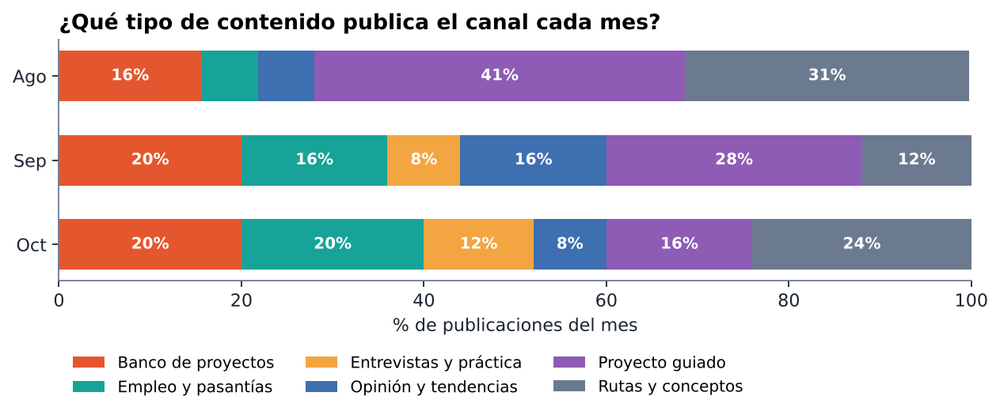
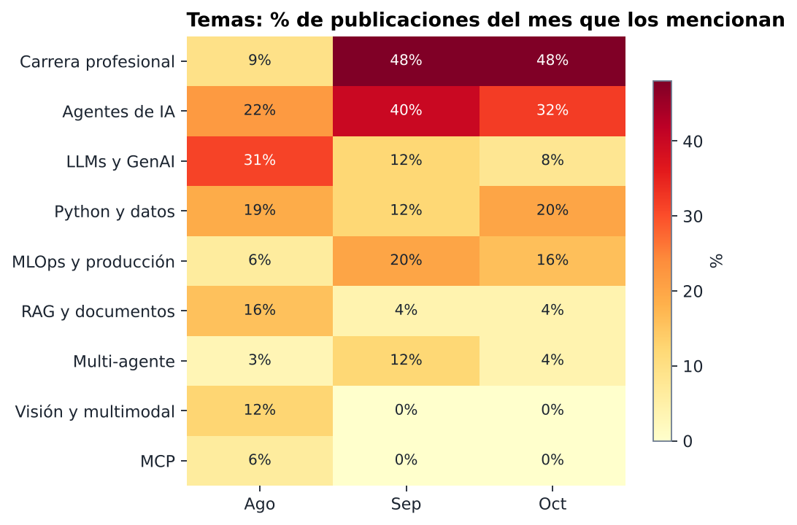
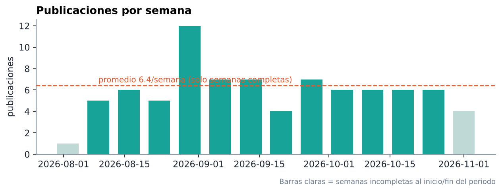

# My Data Diary Analytics

**Análisis de contenido de un canal educativo de IA durante 3 meses (ago–oct 2026).**
Proyecto de portafolio · Analista de datos · Python, pandas, matplotlib, Plotly

📊 **[Ver dashboard interactivo](https://jmanuelhe.github.io/dashboards/my-data-diary.html)**

---

## La pregunta

Durante tres meses documenté cada publicación del canal *My Data Diary* (Aman Kharwal, AI/ML Engineer) en informes mensuales en Word. Los informes eran listas cronológicas, útiles para leer, pero no respondían preguntas como:

- ¿El canal cambió de enfoque con el tiempo, o siempre habla de lo mismo?
- ¿Qué temas crecen y cuáles desaparecen?
- ¿Qué tan constante es publicando?
- Si alguien usa el canal para aprender, **¿qué meses le sirven para construir y cuáles para buscar empleo?**

Este proyecto convierte esos informes en un dataset estructurado y lo analiza.

## Datos

| | |
|---|---|
| Fuente | 3 informes propios en `.docx` (agosto, septiembre, octubre 2026) |
| Extracción | `python-docx`: tablas de cronología → filas; hipervínculos → columna `link` |
| Registros | 82 publicaciones · 2 ago → 30 oct 2026 |
| Columnas | `fecha`, `titulo`, `resumen`, `link`, `informe` (+ derivadas) |

**Limpieza (`src/mdd/clean.py`)**

- Fechas tipo `"2 ago"` → `datetime`.
- **Reenvíos:** se marcan si el título trae “(reenviado)” *o* si el mismo título + link ya apareció. Se encontró 1.
- **Falsos duplicados:** “AI Engineer Jobs & Internships for Freshers” aparece el 27 ago y el 24 sep con links distintos: es una **serie recurrente**, no un duplicado, así que se conserva.
- **Periodos solapados:** el informe de septiembre empieza el 31 ago; se asigna el mes por la fecha, no por el informe.

## Metodología

1. **Clasificación por formato** (una etiqueta): Proyecto guiado, Banco de proyectos, Rutas y conceptos, Empleo y pasantías, Entrevistas y práctica, Opinión y tendencias.
2. **Clasificación por tema** (multi-etiqueta): Agentes de IA, Multi-agente, RAG, LLMs/GenAI, MLOps, Visión/multimodal, MCP, Carrera profesional, Python y datos.
3. Ambas con **reglas regex auditables** en lugar de un modelo: con ~80 filas no hay datos para entrenar, y una regla se puede explicar y corregir. Las reglas se validan contra un conjunto etiquetado a mano en `tests/test_classify.py`.
4. Indicadores: constancia (días con publicación / días del periodo), publicaciones por semana, mezcla de formato por mes, cambio de temas en puntos porcentuales, rachas sin publicar.

## Hallazgos

| Indicador | Valor |
|---|---|
| Publicaciones | **82** en 90 días |
| Días con al menos una publicación | **72 (80 %)** |
| Ritmo | ~6 por semana · racha más larga sin publicar: 4 días (5–8 sep) |
| Día más activo | Viernes (15) · menos activo: sábado (8) |

### 1. El canal pasó de “aprende a construir” a “consigue empleo”



- **Proyectos guiados:** 41 % en agosto → 16 % en octubre.
- **Empleo y pasantías:** 6 % → 20 %. **Entrevistas y práctica:** 0 % → 12 %.

### 2. Los temas técnicos se concentraron en agentes y MLOps



- **Carrera profesional:** 9 % → 48 % de las publicaciones (+39 pp).
- **Agentes de IA** fue el tema técnico dominante desde septiembre (40 % y 32 %).
- **MLOps y producción** se triplicó: 6 % → 20 % → 16 %.
- **LLMs/GenAI** cayó de 31 % a 8 %; **visión, multimodal y MCP** no volvieron a aparecer después de agosto.

### 3. Publica de forma constante



### Recomendación

Para alguien que usa el canal para formarse: **el archivo de agosto es el mejor material para construir proyectos** (RAG, visión, MCP), y **septiembre–octubre son el material para preparar la búsqueda de empleo** (entrevistas, ofertas, MLOps, agentes). Por eso los demás proyectos de este portafolio salen de esas dos fuentes.

## Cómo ejecutarlo

```bash
pip install -r requirements.txt
python run.py          # genera data/processed, reports/figures, reports/dashboard.html y reports/results.json
python -m pytest -q    # 18 tests
```

## Estructura

```
data/raw/posts_raw.csv          # extraído de los informes .docx
data/processed/posts_clean.csv  # limpio + formato + temas
src/mdd/clean.py                # limpieza, reenvíos, columnas derivadas
src/mdd/classify.py             # reglas de formato y tema
src/mdd/analyze.py              # KPIs y tablas
src/mdd/viz.py                  # gráficos y dashboard
tests/                          # validación de limpieza y reglas
```

## Limitaciones

- La clasificación usa solo el **título**. Un título ambiguo puede quedar mal etiquetado. Los casos difíciles están cubiertos por tests, pero no todos.
- Tres meses es poco para hablar de estacionalidad.
- 7 de 82 publicaciones no tienen link confirmado (vistas solo en Threads).

## Próximos pasos

- Clasificar también por el `resumen` con embeddings y comparar contra las reglas.
- Automatizar la captura mensual desde el blog del autor.
